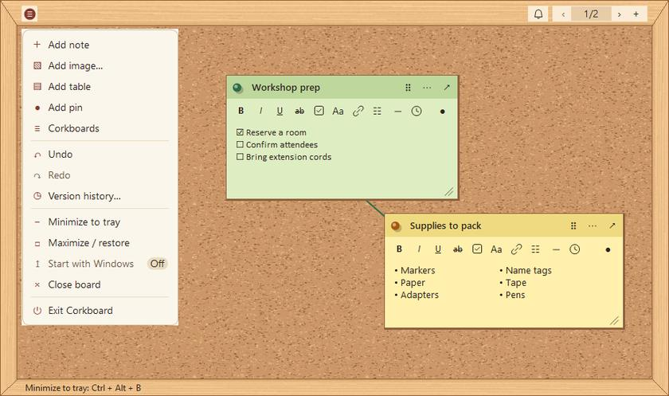
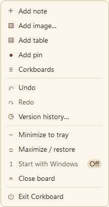
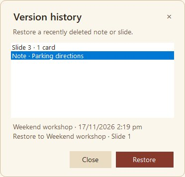
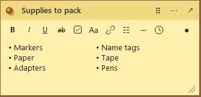
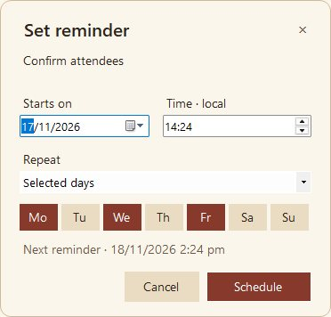

# Classic Corkboard

[](#requirements) [](LICENSE)

Pin notes, photos, and tables to a classic corkboard on your Windows desktop. The app is small, works offline, and saves your board on your PC without an account. Pop out a sticky note when you want it in view, then tuck the board into the tray.

## In v0.8.0

Recover deleted notes and slides after a restart, schedule reminders for selected weekdays, and arrange note lists in rows or columns. The Board menu fits at the smallest supported board size, with a visible Windows startup status.



## Requirements

- Windows 10 or 11
- [.NET 8 SDK](https://dotnet.microsoft.com/en-us/download/dotnet/8.0) to build from source
- .NET 8 Desktop Runtime for the framework-dependent executable. The Windows SDK installation includes the runtime.

## Quick start

```powershell
git clone https://github.com/JFellores/Classic-Corkboard.git
cd Classic-Corkboard
dotnet run --project .\src\Corkboard\Corkboard.csproj
```

### Build a portable Windows executable

```powershell
dotnet publish .\src\Corkboard\Corkboard.csproj -c Release -r win-x64 --self-contained false -p:PublishSingleFile=true -p:EnableSingleFileAnalyzer=false -o .\artifacts\win-x64
```

Open `artifacts\win-x64\Corkboard.exe` on an x64 Windows PC with the .NET 8 Desktop Runtime. If an earlier copy is running in the tray, exit it before launching the new build.

## Feature guide

### Notes and boards

- **Create a note.** Double-click an empty area of the cork or choose **Add note** from the **Board menu**. Click inside the card to type. Drag the lower-right grip to resize it.
- **Label or color a note.** Click its label area, or open the card’s **⋯** menu for **Edit label** and **Note color**.
- **Manage boards and notes.** Open **Board menu → Corkboards**. Use **New board**, **Open**, **Rename**, or **Delete board**. Select a saved note to open or delete it. More than one board can be open at a time.
- **Keep a note visible.** Use the card’s **↗** button or **⋯ → Pop out note**. Choose **Keep above other windows** when you need the card in view while using another app.
- **Use the Windows tray.** Choose **Board menu → Minimize to tray** and click the Corkboard tray icon to reopen it. Use **Start with Windows** in the Board menu to launch Corkboard when you sign in. The **On** or **Off** badge shows the current setting.



### Recover deleted notes and slides

1. Open **Board menu → Version history…** or choose **Version history…** from the Corkboard tray icon’s menu.
2. Select an entry to see when and where it was deleted, then click **Restore**.
3. A card returns to the board’s current slide. A slide returns with its cards, images, tables, and pins. Corkboard reconnects threads when both pins are present. Your later edits stay in place.

Recovery history is stored locally and holds up to 50 recent deletions within its storage limit. It starts with deletions made in v0.8.0. Use **Ctrl+Z** and **Ctrl+Y** to undo or redo edits across boards during the current session.



[Watch a deleted note return to the board](docs/images/restore-note-0.8.0.gif).

### Pins and threads

- **Connect two cards.** Click the first card’s pin to pin it, open its pin menu, and choose **Add thread**. A preview follows the pointer. Click the destination card to connect it, or press **Esc** to cancel.
- **Change colors or remove a thread.** Open the pin menu for **Pin color**. Click a thread to select its color or remove it.
- **Move a pinned card.** Hold and drag its pin to move the card with its threads attached. A quick click opens pin options. Use **Move with pin** if you prefer dragging the card by its handle.
- **Identify a connection.** Click a thread to see both card labels. Choose **Match starting note** to keep the thread color in sync with the source card.

### Images

- Choose **Board menu → Add image…** and select a local photo. Resize it with the corner grip. Pin, connect, or pop out the image using the card controls.
- Resize an image card smaller for a postage-stamp frame or larger for an instant-photo frame. Its pin and threads stay attached.

### Slides and card placement

- Click **+** on the top frame to add a slide and use the arrows to switch. Open the numbered slide counter to jump to a slide or delete the current one. With Windows animations enabled, cards appear after each slide settles and threads draw from their source pins.
- Choose **Move to slide** from a card’s pin menu to move it with its threads attached. To connect cards across slides, choose **Add thread**, switch slides, and click the destination card.
- Right-click open cork and choose **Add note**, **Add image…**, or **Add table** to place a card near the pointer. New cards pop in when Windows animations are enabled.

### Checklists and text formatting

- Select text and choose **Checklist** in the note toolbar. Click the box to check or uncheck the item. Checked items appear crossed out.
- Select text and click **Aa** to change its font, size, color, or opacity. Sizes range from **1–24 pt**. **Use default** restores the default size shown in the dialog. With just the cursor in the note, the changes apply to text you type next.
- To reset checkboxes on a schedule, open **⋯ → Note rules…**, choose **An item is checked**, then set **Checklist reset** to a daily time or a delay after each item is checked. Click **Save**.
- Click the chain-link icon in the note toolbar or press Ctrl+K while editing. Enter a web address and the text you want the note to display, then pick a color. Select the link and click **Checklist** to add a checkbox. The box marks the item complete, and the linked text opens the address.
- Select lines and click **List style** to cycle through bullets, numbers, dashes, and plain text. Use **Divider** to insert a full-width line and cycle through solid, dashed, double, and removed. On narrow notes, open **⋯** for tools that do not fit.
- Bulleted and numbered lists start with compact indentation. To adjust an existing list, select its lines and choose **Formatting → List indent → Compact** or **Standard** from the note’s top-right **⋯** menu.
- Click a divider to select it. Use **Bold** for a thicker line or **Underline** for an extra line underneath. Typing with the divider selected continues on the next line.
- Click the clock in the note toolbar to insert the local date and time, such as `15/11/2026 9:30 AM`. Open **⋯ → Formatting → Timestamp format…** to preview a different date format and choose the timestamp’s appearance.
- For markers you can space, indent, or delete by hand, select lines and open **⋯ → Formatting → Free-form list**. Choose **Bullets**, **Numbers**, or **Dashes**.

### Arrange a list or read a long note

- Select the lines of a bulleted, numbered, or dashed list. Right-click and choose **List layout → Across a row** or **2 columns**, **3 columns**, or **4 columns**. Long labels can use a full row. Choose **Single column** to stack the items again.
- For longer notes, choose **⋯ → Formatting → Reading mode → Scroll** or **Pages**. In page mode, use the page controls to move through the note.



### Note rules

- Choose **⋯ → Note rules…** to set a whole-note rule. For a rule that applies to a word, sentence, or checklist item, select it and choose **Set rule…** from the right-click menu.
- Pick a **When** trigger and add **Then** actions. For example, checking an item can add a timestamp or move the affected text to a connected note. Use **Also when…** to share those actions across triggers. Save the rule or choose **Remove rule** to delete it.

### Reminders

- Select text in a note and choose **Set reminder…** from the right-click menu. Pick a local date and time, then choose **Once**, **Daily**, or **Selected days**. For selected days, click the weekdays you want before clicking **Schedule**.
- Open the bell on the board frame to see **Notifications** and **Scheduled** reminders. Use **Done**, **Stop**, or **Snooze 5 min** when a reminder appears. The **⋯** menu has **Clear completed** and **Sound settings…**, including volume, repeat playback, and custom WAV files up to 30 seconds.



### Tables and formulas

- In a Table card, click a cell and type, then press Enter to save the edit. Use **+ Add row** or select a row and choose **Delete row**. The menu next to those buttons has column actions and formula examples. Each table holds up to 20 rows and 8 columns.
- Drag across cells or use Shift and the arrow keys to select a range. Use Ctrl+C, Ctrl+X, or Ctrl+V to copy, cut, or paste a rectangle of cells. Press Delete to clear the selected cells.
- Type `=B1` to read B1, or `=$B1` to keep column B fixed when you copy the formula. Use `=SUM(B2:B4)` to total a range. Table cards also support `MAX`, `MIN`, `AVERAGE`, and `COUNT`. Click a formula in **Formula examples…** to copy it. Press F2 on a result to edit the formula.
- Type `=` and click a cell to insert its address. To total a range in one cell, type `=SUM(`, drag across the source cells, and press Enter. The source range is highlighted while you edit.

### Local storage and backups

Corkboard saves your data in `%LOCALAPPDATA%\Corkboard` by default. To make a separate backup, exit Corkboard from the tray, then copy the entire folder so your notes and attached images stay together. See [.env.example](.env.example) for the optional development override.

## Keyboard shortcuts

| Shortcut | Action |
| --- | --- |
| Ctrl+Alt+B | Minimize or reopen the most recently used board from any app while Corkboard is running. The bottom-left frame reads `Minimize to tray: Ctrl + Alt + B`. |
| Ctrl+N | Add a note. |
| Ctrl+Z / Ctrl+Y | Undo or redo an edit across boards. |
| Ctrl+Page Up / Ctrl+Page Down | Go to the previous or next slide. |
| Ctrl+Shift+B | Toggle the Corkboards drawer. |
| Ctrl+B / Ctrl+I / Ctrl+U | Bold, italic, or underline note text. |
| Ctrl+K | Insert a web link with optional display text in a note. |
| Ctrl+Shift+L | Turn selected note text into a checklist. |
| Ctrl+Shift+Enter | Check or uncheck the item at the cursor. |
| Esc | Cancel pin or thread selection or close the board controls. |

## Project history and help

See the [changelog](CHANGELOG.md) for changes by version.

For help or feature requests, use [GitHub Issues](https://github.com/JFellores/Classic-Corkboard/issues). See [CONTRIBUTING.md](CONTRIBUTING.md) to submit a change and [SECURITY.md](SECURITY.md) to report a vulnerability.

Maintained by [JFellores](https://github.com/JFellores). Source is available under the [MIT License](LICENSE).
