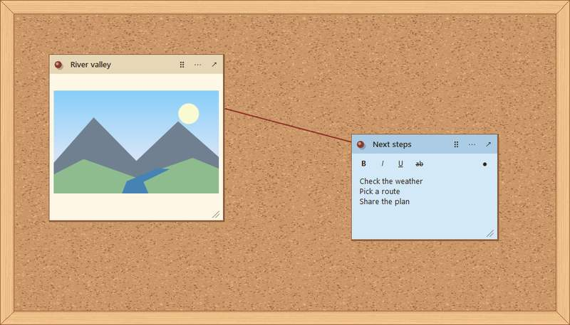

# Classic Corkboard

[](#requirements) [](LICENSE)

Pin notes and photos to a classic corkboard on your Windows desktop. The app is small, works offline, and saves your board on your PC without an account. Pop out a sticky note when you want it in view, then tuck the board into the tray.

## In v0.5.0

**Image cards.** Added local image imports, resizing and pop-outs for images, and support for pinning and connecting image cards.

## Screenshots



An imported image attached to a note. (v0.5.0)

## Requirements

- Windows 10 or 11
- [.NET 8 SDK](https://dotnet.microsoft.com/en-us/download/dotnet/8.0) to build from source
- .NET 8 Desktop Runtime for the framework-dependent executable. The Windows SDK installation includes the runtime.

## Quick start

```powershell
git clone https://github.com/JFellores/Classic-Corkboard.git
cd Classic-Corkboard
dotnet run --project .\src\Corkboard\Corkboard.csproj
```

### Build a portable Windows executable

```powershell
dotnet publish .\src\Corkboard\Corkboard.csproj -c Release -r win-x64 --self-contained false -p:PublishSingleFile=true -p:EnableSingleFileAnalyzer=false -o .\artifacts\win-x64
```

Open `artifacts\win-x64\Corkboard.exe` on an x64 Windows PC with the .NET 8 Desktop Runtime. If an earlier copy is running in the tray, exit it before launching the new build.

## Feature guide

### Notes and boards

- **Create a note.** Double-click an empty area of the cork or choose **Add note** from the **Board menu**. Click inside the card to type. Drag the lower-right grip to resize it.
- **Label or color a note.** Click its label area, or open the card’s **⋯** menu for **Edit label** and **Note color**.
- **Manage boards and notes.** Open **Board menu → Corkboards**. Use **New board**, **Open**, **Rename**, or **Delete board**. Select a saved note to open or delete it. More than one board can be open at a time.
- **Keep a note visible.** Use the card’s **↗** button or **⋯ → Pop out note**. Choose **Keep above other windows** when you need the card in view while using another app.
- **Use the Windows tray.** Choose **Board menu → Minimize to tray** and click the Corkboard tray icon to reopen it. Use **Start with Windows** in the Board menu to launch Corkboard when you sign in.

### Pins and threads

- **Connect two cards.** Click the first card’s pin to pin it, open its pin menu, and choose **Add thread**. A preview follows the pointer. Click the destination card to connect it, or press **Esc** to cancel.
- **Change colors or remove a thread.** Open the pin menu for **Pin color**. Click a thread to select its color or remove it.

### Images

- Choose **Board menu → Add image…** and select a local photo. Resize it with the corner grip. Pin, connect, or pop out the image using the card controls.

### Local storage and backups

Corkboard saves your data in `%LOCALAPPDATA%\Corkboard` by default. To make a separate backup, exit Corkboard from the tray, then copy the entire folder so your notes and attached images stay together. See [.env.example](.env.example) for the optional development override.

## Project history and help

This repository publishes recovered source snapshots in version order, beginning with the first working build. The [changelog](CHANGELOG.md) describes what each snapshot contains.

For help or feature requests, use [GitHub Issues](https://github.com/JFellores/Classic-Corkboard/issues). See [CONTRIBUTING.md](CONTRIBUTING.md) to submit a change and [SECURITY.md](SECURITY.md) to report a vulnerability.

Maintained by [JFellores](https://github.com/JFellores). Source is available under the [MIT License](LICENSE).
