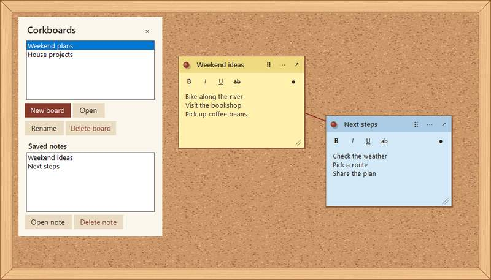

# Classic Corkboard

[](#requirements) [](LICENSE)

Pin notes to a classic corkboard on your Windows desktop. The app is small, works offline, and saves your board on your PC without an account. Pop out a sticky note when you want it in view, then tuck the board into the tray.

## In v0.4.0

**Cork boundaries and deletion.** Kept notes within the visible board, refreshed the floating Board menu, and added confirmed deletion for boards and notes.

## Screenshots



Board and note deletion from the drawer. (v0.4.0)

## Requirements

- Windows 10 or 11
- [.NET 8 SDK](https://dotnet.microsoft.com/en-us/download/dotnet/8.0) to build from source
- .NET 8 Desktop Runtime for the framework-dependent executable. The Windows SDK installation includes the runtime.

## Quick start

```powershell
git clone https://github.com/JFellores/Classic-Corkboard.git
cd Classic-Corkboard
dotnet run --project .\src\Corkboard\Corkboard.csproj
```

### Build a portable Windows executable

```powershell
dotnet publish .\src\Corkboard\Corkboard.csproj -c Release -r win-x64 --self-contained false -p:PublishSingleFile=true -p:EnableSingleFileAnalyzer=false -o .\artifacts\win-x64
```

Open `artifacts\win-x64\Corkboard.exe` on an x64 Windows PC with the .NET 8 Desktop Runtime. If an earlier copy is running in the tray, exit it before launching the new build.

## Use the board

1. Double-click the cork or use the floating board menu to create a note. Use the Corkboards drawer to switch between boards.
2. Pop out a reminder to keep it visible while using other apps.
3. Minimize the board to the Windows notification area. Click the tray icon to bring it back.
4. Click a note’s pin to lock it in place. Open the pin menu again to connect it to another note with a thread.

The default data folder is `%LOCALAPPDATA%\Corkboard`. See [.env.example](.env.example) for the optional development override.

## Project history and help

This repository publishes recovered source snapshots in version order, beginning with the first working build. The [changelog](CHANGELOG.md) describes what each snapshot contains.

For help or feature requests, use [GitHub Issues](https://github.com/JFellores/Classic-Corkboard/issues). See [CONTRIBUTING.md](CONTRIBUTING.md) to submit a change and [SECURITY.md](SECURITY.md) to report a vulnerability.

Maintained by [JFellores](https://github.com/JFellores). Source is available under the [MIT License](LICENSE).
