# Classic Corkboard

[](#requirements) [](LICENSE)

Pin notes, photos, and tables to a classic corkboard on your Windows desktop. The app is small, works offline, and saves your board on your PC without an account. Pop out a sticky note when you want it in view, then tuck the board into the tray.

## In v0.7.3

**Add slides, checklists, and table cards.** Added numbered slides with no scrollbars on the cork surface. After each slide settles, its cards pop in and threads draw from their source pins. Right-click the cork to add a note, image, or table. Table cards support range selection, copy and paste, editable rows and columns, and five aggregate functions. Click or drag across cells while writing a formula to insert their reference. Select note text to turn it into a checklist item, change its size, or turn it into a clickable web link. Choose a daily checklist reset time on any note. Press Ctrl+Alt+B to minimize or restore the corkboard from any app.

## Screenshots

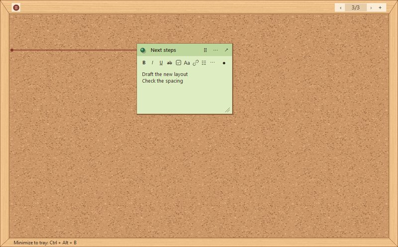

Numbered slide controls and a thread leading to another slide (v0.7.3).

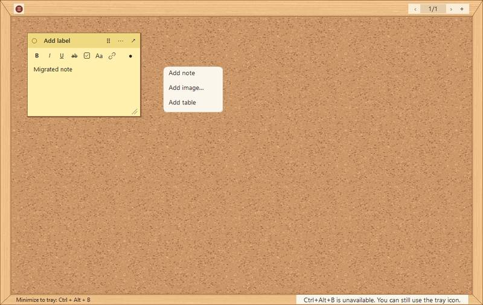

Right-click the cork to add a note, image, or table (v0.7.3).

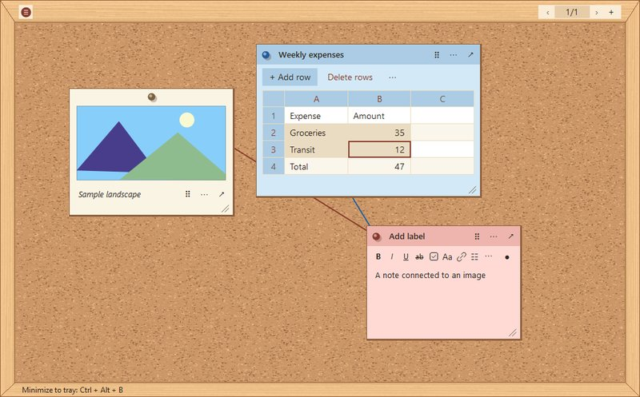

Drag across cells to select a range (v0.7.3).

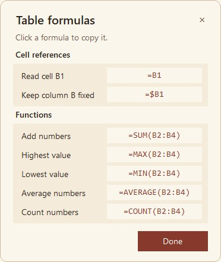

Click a formula example to copy it (v0.7.3).

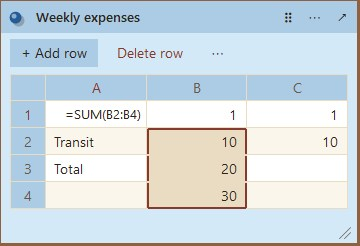

Select cells while typing to insert their reference into the formula (v0.7.3).

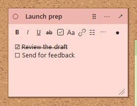

A checklist with completed and pending items (v0.7.3).

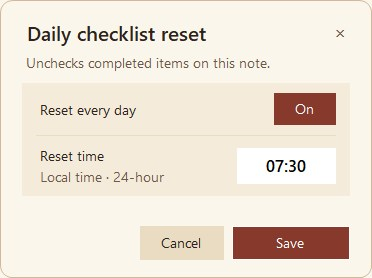

Choose when the note unchecks its completed items (v0.7.3).

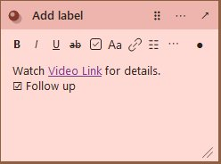

Choose the display text and color for a clickable web link (v0.7.3).

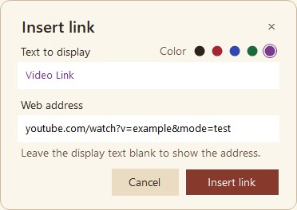

Pick a link color and preview it in the display text field (v0.7.3).

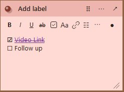

Links remain clickable in checklist items (v0.7.3).

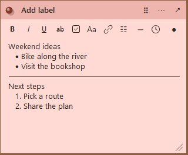

Cycle list and divider styles from the note toolbar (v0.7.3).

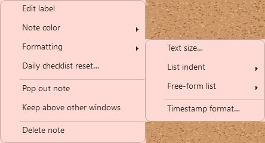

Find text size, list options, and timestamp format under Formatting (v0.7.3).

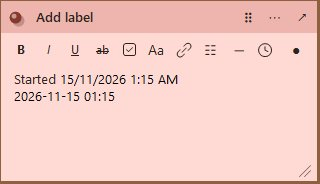

Insert the current local date and time at the cursor (v0.7.3).

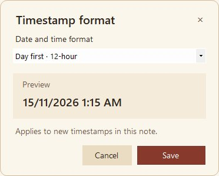

Choose how new timestamps appear in a note (v0.7.3).

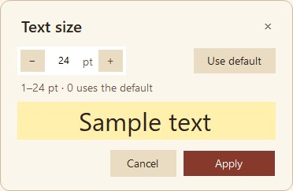

Choose a size from 1–24 pt, or enter 0 for the default (v0.7.3).

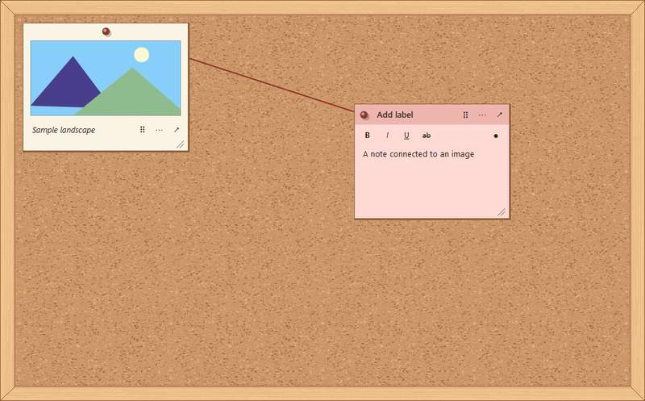

A photo card connected to a note on the wooden board (v0.5.2).

## Requirements

- Windows 10 or 11
- [.NET 8 SDK](https://dotnet.microsoft.com/en-us/download/dotnet/8.0) to build from source
- .NET 8 Desktop Runtime for the framework-dependent executable. The Windows SDK installation includes the runtime.

## Quick start

```powershell
git clone https://github.com/JFellores/Classic-Corkboard.git
cd Classic-Corkboard
dotnet run --project .\src\Corkboard\Corkboard.csproj
```

### Build a portable Windows executable

```powershell
dotnet publish .\src\Corkboard\Corkboard.csproj -c Release -r win-x64 --self-contained false -p:PublishSingleFile=true -p:EnableSingleFileAnalyzer=false -o .\artifacts\win-x64
```

Open `artifacts\win-x64\Corkboard.exe` on an x64 Windows PC with the .NET 8 Desktop Runtime. If an earlier copy is running in the tray, exit it before launching the new build.

## Feature guide

### Notes and boards

- **Create a note.** Double-click an empty area of the cork or choose **Add note** from the **Board menu**. Click inside the card to type. Drag the lower-right grip to resize it.
- **Label or color a note.** Click its label area, or open the card’s **⋯** menu for **Edit label** and **Note color**.
- **Manage boards and notes.** Open **Board menu → Corkboards**. Use **New board**, **Open**, **Rename**, or **Delete board**. Select a saved note to open or delete it. More than one board can be open at a time.
- **Keep a note visible.** Use the card’s **↗** button or **⋯ → Pop out note**. Choose **Keep above other windows** when you need the card in view while using another app.
- **Use the Windows tray.** Choose **Board menu → Minimize to tray** and click the Corkboard tray icon to reopen it. Use **Start with Windows** in the Board menu to launch Corkboard when you sign in.

### Pins and threads

- **Connect two cards.** Click the first card’s pin to pin it, open its pin menu, and choose **Add thread**. A preview follows the pointer. Click the destination card to connect it, or press **Esc** to cancel.
- **Change colors or remove a thread.** Open the pin menu for **Pin color**. Click a thread to select its color or remove it.
- **Move a pinned card.** Hold and drag its pin to move the card with its threads attached. A quick click opens pin options. Use **Move with pin** if you prefer dragging the card by its handle.
- **Identify a connection.** Click a thread to see both card labels. Choose **Match starting note** to keep the thread color in sync with the source card.

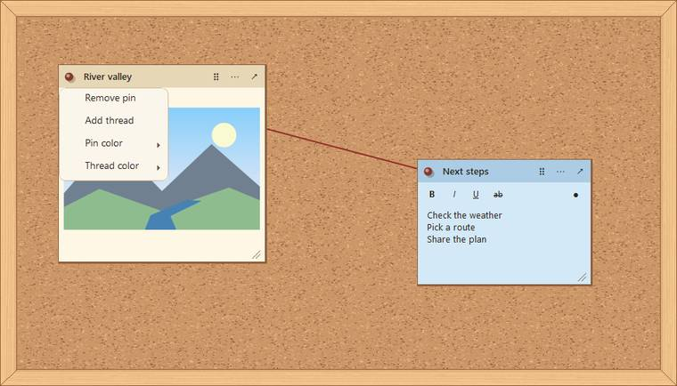

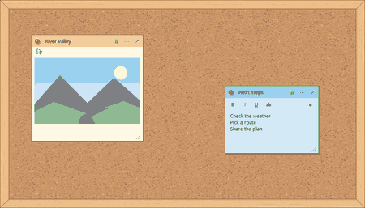

### Images

- Choose **Board menu → Add image…** and select a local photo. Resize it with the corner grip. Pin, connect, or pop out the image using the card controls.
- Resize an image card smaller for a postage-stamp frame or larger for an instant-photo frame. Its pin and threads stay attached.

### Slides and card placement

- Click **+** on the top frame to add a slide and use the arrows to switch. Open the numbered slide counter to jump to a slide or delete the current one. With Windows animations enabled, cards appear after each slide settles and threads draw from their source pins.
- Choose **Move to slide** from a card’s pin menu to move it with its threads attached. To connect cards across slides, choose **Add thread**, switch slides, and click the destination card.
- Right-click open cork and choose **Add note**, **Add image…**, or **Add table** to place a card near the pointer. New cards pop in when Windows animations are enabled.

### Checklists and text formatting

- Select text and choose **Checklist** in the note toolbar. Click the box to check or uncheck the item. Checked items appear crossed out.
- Select text and click **Aa** to preview and apply a size from **1–24 pt**. Click **Use default** or enter **0** to reset. With the cursor in the note, choose a size for the text you type next.
- In the note’s **…** menu, choose **Daily checklist reset…**, switch **Reset every day** to **On**, enter a local time such as `07:30`, and click **Save**. If Corkboard is closed at that time, it catches up when you reopen it.
- Click the chain-link icon in the note toolbar or press Ctrl+K while editing. Enter a web address and the text you want the note to display, then pick a color. Select the link and click **Checklist** to add a checkbox. The box marks the item complete, and the linked text opens the address.
- Select lines and click **List style** to cycle through bullets, numbers, dashes, and plain text. Use **Divider** to insert a full-width line and cycle through solid, dashed, double, and removed. On narrow notes, open **⋯** for tools that do not fit.
- Bulleted and numbered lists start with compact indentation. To adjust an existing list, select its lines and choose **Formatting → List indent → Compact** or **Standard** from the note’s top-right **⋯** menu.
- Click a divider to select it. Use **Bold** for a thicker line or **Underline** for an extra line underneath. Typing with the divider selected continues on the next line.
- Click the clock in the note toolbar to insert the local date and time, such as `15/11/2026 9:30 AM`. Open **⋯ → Formatting → Timestamp format…** to preview and save a different format for that note.
- For markers you can space, indent, or delete by hand, select lines and open **⋯ → Formatting → Free-form list**. Choose **Bullets**, **Numbers**, or **Dashes**.

### Tables and formulas

- In a Table card, click a cell and type, then press Enter to save the edit. Use **+ Add row** or select a row and choose **Delete row**. The menu next to those buttons has column actions and formula examples. Each table holds up to 20 rows and 8 columns.
- Drag across cells or use Shift and the arrow keys to select a range. Use Ctrl+C, Ctrl+X, or Ctrl+V to copy, cut, or paste a rectangle of cells. Press Delete to clear the selected cells.
- Type `=B1` to read B1, or `=$B1` to keep column B fixed when you copy the formula. Use `=SUM(B2:B4)` to total a range. Table cards also support `MAX`, `MIN`, `AVERAGE`, and `COUNT`. Click a formula in **Formula examples…** to copy it. Press F2 on a result to edit the formula.
- Type `=` and click a cell to insert its address. To total a range in one cell, type `=SUM(`, drag across the source cells, and press Enter. The source range is highlighted while you edit.

### Local storage and backups

Corkboard saves your data in `%LOCALAPPDATA%\Corkboard` by default. To make a separate backup, exit Corkboard from the tray, then copy the entire folder so your notes and attached images stay together. See [.env.example](.env.example) for the optional development override.

## Keyboard shortcuts

| Shortcut | Action |
| --- | --- |
| Ctrl+Alt+B | Minimize or reopen the most recently used board from any app while Corkboard is running. The bottom-left frame reads `Minimize to tray: Ctrl + Alt + B`. |
| Ctrl+N | Add a note. |
| Ctrl+Page Up / Ctrl+Page Down | Go to the previous or next slide. |
| Ctrl+Shift+B | Toggle the Corkboards drawer. |
| Ctrl+B / Ctrl+I / Ctrl+U | Bold, italic, or underline note text. |
| Ctrl+K | Insert a web link with optional display text in a note. |
| Ctrl+Shift+L | Turn selected note text into a checklist. |
| Ctrl+Shift+Enter | Check or uncheck the item at the cursor. |
| Esc | Cancel pin or thread selection or close the board controls. |

## Project history and help

This repository publishes recovered source snapshots in version order, beginning with the first working build. The [changelog](CHANGELOG.md) describes what each snapshot contains.

For help or feature requests, use [GitHub Issues](https://github.com/JFellores/Classic-Corkboard/issues). See [CONTRIBUTING.md](CONTRIBUTING.md) to submit a change and [SECURITY.md](SECURITY.md) to report a vulnerability.

Maintained by [JFellores](https://github.com/JFellores). Source is available under the [MIT License](LICENSE).
